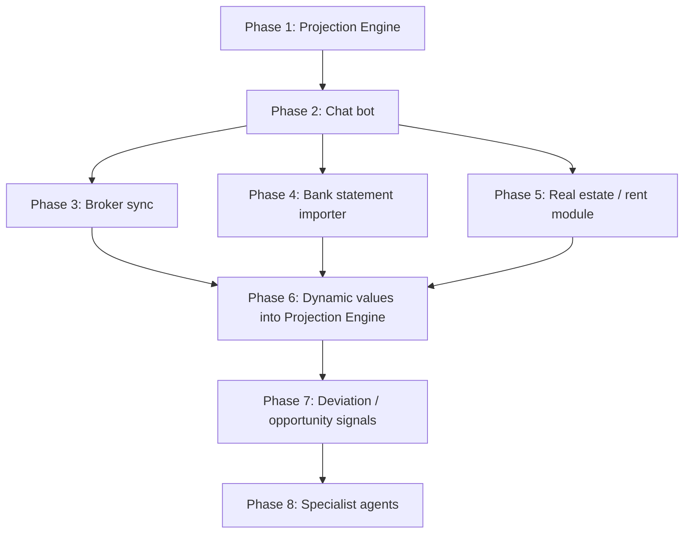

# Wealth Building & FIRE Planning — Overall Plan

## Vision
Extend `splitapi` beyond pure expense tracking into a personal wealth-building
and FIRE-planning system: net worth, investments, real estate, and a
conversational interface — built incrementally, static-to-dynamic, and
single-bot-to-multi-agent.

## Guiding decisions (from research)

- **No ready-made GitHub repo covers Indian broker/bank integration.** Use
  official SDKs as plain dependencies, not adopted/forked repos:
  - `breeze-connect` (pip) — official ICICI Direct Breeze SDK
    ([Idirect-Tech/Breeze-Python-SDK](https://github.com/Idirect-Tech/Breeze-Python-SDK)).
  - `smartapi-python` (pip) — official Angel One SmartAPI SDK. Install from
    PyPI only; avoid cloning community GitHub mirrors/forks (several contain
    hardcoded credentials/TOTP secrets in example code).
- **Skip the Account Aggregator / FIU route for bank data.** Becoming an FIU
  is designed for regulated entities, not personal projects. Use statement
  import (CSV/PDF export from ICICI Bank and Standard Chartered netbanking)
  instead, following the "bulk import with LLM-assisted normalization"
  pattern seen in `xiapuyang/fin`'s `fin-import` skill.
- **Avoid "LLM writes raw SQL" style chat tools** (e.g. `vanna-ai/vanna` —
  now archived — or PandasAI-style code execution) for the chat interface.
  Given a small, fully-known schema, a whitelisted tool-calling approach
  (LLM picks from a fixed set of typed functions) is safer and auditable.
- **Defer true A2A protocol adoption.** Start with a single orchestrator +
  a flat, growing tool registry (same pattern `money-desk` uses for its
  specialists, minus the live agent-to-agent RPC). Only reach for
  `a2aproject/a2a-python` if specialists need to run as independently
  deployable services later.
- **Build the Projection Engine first, with static config.** It doesn't need
  live data, and it's a direct port of the existing spreadsheet — the most
  concrete, self-contained piece of the whole plan.
- **Include the chat/bot interface in v1**, not deferred alongside the
  specialist agents. It starts as a thin tool-calling layer over existing +
  projection APIs, and becomes the seed of the Phase 8 orchestrator later —
  same tool schema, more tools added over time.

## Roadmap

| Phase | Scope | Depends on |
|---|---|---|
| 1 | **Projection Engine** — DB-backed, user-editable assumptions (not just static config), port of the existing spreadsheet (year-by-year expense/income/cash/equity/debt waterfall), schema designed so Phase 6 can later override seed fields with live data | — |
| 2 | **Chat bot** — tool-calling layer over existing `splitapi` endpoints + `/api/fire-projection` | Phase 1 |
| 3 | **Broker sync** — Angel One SmartAPI + ICICI Direct Breeze, read-only holdings/transactions sync | — (parallel to 1/2) |
| 4 | **Bank statement importer** — ICICI Bank + Standard Chartered, CSV/PDF import | — (parallel to 1/2) |
| 5 | **Real estate / rent module** — manual asset entries, rent income/expense reusing existing expense categorization | — (parallel to 1/2) |
| 6 | **Wire dynamic values into the Projection Engine** — replace static `current_value` inputs with live lookups against holdings/balance snapshots | 3, 4, 5 |
| 7 | **Daily deviation / opportunity signal engine** — deterministic rules comparing actuals vs. projection, not Monte Carlo | 6, needs >1–2 months of snapshot history |
| 8 | **Specialist agents** — evolve the Phase 2 bot's flat tool registry into specialist-scoped tool sets (FIRE, real estate, tax) with routing; India-specific content authored from scratch (money-desk's specialists are US-only and not reusable) | 7 |

## Current status
- Phase 1 is being scoped in detail in `01-phase-1-projection-engine.md`.
- All other phases remain at roadmap-level detail until Phase 1 is scoped
  and implemented.
